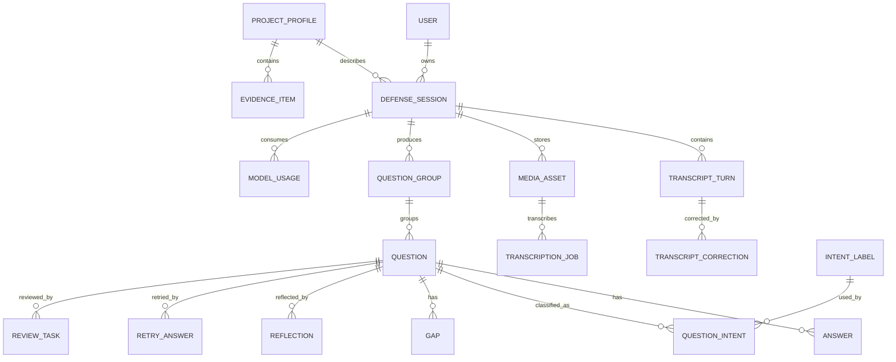

# 数据模型 v0.1

- 版本：v0.1
- 日期：2026-11-17
- 数据库建议：PostgreSQL
- 主键建议：UUID
- 设计目标：问题卡优先、原文可追溯、追问链完整、支持长期复习和成本统计

## 1. 建模原则

- 原始转写与结构化问题分开保存。
- 一个问题组可以包含多个问题和追问。
- 回答与问题分开保存，支持重答和多次反思。
- AI 判断必须保留证据、置信度和用户确认状态。
- 成本记录按模型调用保存，便于计算单场费用。
- 敏感字段不进入公开示例数据。
- 删除用户数据时，原始文本、录音和分析结果一起处理。

## 2. 核心实体关系



## 3. 实体定义

### 3.1 User

首版可以使用本地单用户模式，但保留用户实体便于后续账户和导出。

| 字段 | 类型 | 说明 |
|---|---|---|
| id | UUID | 主键 |
| display_name | varchar(100) | 显示名称，可空 |
| email | varchar(255) | 登录邮箱，可空 |
| locale | varchar(20) | 默认 zh-CN |
| created_at | timestamptz | 创建时间 |
| updated_at | timestamptz | 更新时间 |

### 3.2 ProjectProfile

记录用户要讲解的软件项目，用于后续证据匹配和问题生成。

| 字段 | 类型 | 说明 |
|---|---|---|
| id | UUID | 主键 |
| user_id | UUID | 所属用户 |
| name | varchar(200) | 项目名称 |
| summary | text | 一句话介绍 |
| target_users | text | 目标用户 |
| problem_statement | text | 解决的问题 |
| tech_stack | jsonb | 技术栈和版本 |
| user_role | text | 用户个人负责范围 |
| team_size | integer | 团队规模 |
| project_stage | varchar(50) | 课程、比赛、毕业设计、上线项目等 |
| created_at | timestamptz | 创建时间 |
| updated_at | timestamptz | 更新时间 |

### 3.3 DefenseSession

一次答辩、面试或模拟问答的复盘场次。

| 字段 | 类型 | 说明 |
|---|---|---|
| id | UUID | 主键 |
| user_id | UUID | 所属用户 |
| project_profile_id | UUID | 关联项目，可空 |
| title | varchar(200) | 场次标题 |
| session_type | varchar(50) | defense、interview、mock、presentation |
| occurred_at | timestamptz | 实际发生时间 |
| duration_seconds | integer | 时长 |
| source_type | varchar(30) | text、audio、video |
| source_reference | text | 私有文件引用或空 |
| status | varchar(30) | draft、processing、ready、failed |
| raw_text | text | 原始文本，可加密或私有存储 |
| processing_error | text | 失败信息 |
| created_at | timestamptz | 创建时间 |
| updated_at | timestamptz | 更新时间 |

索引：

- `(user_id, occurred_at desc)`
- `(status)`

### 3.4 TranscriptTurn

保留原始发言顺序、角色和文本位置，确保所有分析可追溯。

| 字段 | 类型 | 说明 |
|---|---|---|
| id | UUID | 主键 |
| session_id | UUID | 所属场次 |
| sequence_no | integer | 发言顺序 |
| speaker_role | varchar(50) | user、reviewer、professor、expert、unknown |
| speaker_label | varchar(100) | 页面显示的角色名称 |
| text | text | 原始发言 |
| start_ms | integer | 音频开始时间，可空 |
| end_ms | integer | 音频结束时间，可空 |
| turn_type | varchar(30) | question、answer、statement、noise、unknown |
| created_at | timestamptz | 创建时间 |

约束：

- 同一场次的 `sequence_no` 唯一。
- 原始文本不应被 AI 直接覆盖，修正通过独立字段或版本记录完成。

### 3.5 QuestionGroup

表示一个主问题及其追问链。

| 字段 | 类型 | 说明 |
|---|---|---|
| id | UUID | 主键 |
| session_id | UUID | 所属场次 |
| group_no | integer | 问题编号 |
| title | varchar(300) | 问题摘要 |
| primary_question_id | UUID | 主问题 |
| chain_summary | text | 追问链摘要 |
| severity | smallint | 1 到 5，表示复盘优先级 |
| status | varchar(30) | open、reviewed、mastered |
| created_at | timestamptz | 创建时间 |
| updated_at | timestamptz | 更新时间 |

### 3.6 Question

保存单个问题和它在追问链中的位置。

| 字段 | 类型 | 说明 |
|---|---|---|
| id | UUID | 主键 |
| group_id | UUID | 所属问题组 |
| source_turn_id | UUID | 原始发言 |
| parent_question_id | UUID | 上一个追问，可空 |
| depth | integer | 主问题为 0，追问依次增加 |
| question_text | text | 结构化问题文本 |
| asker_role | varchar(50) | 提问者角色 |
| question_type | varchar(50) | main、follow_up、clarification |
| is_user_edited | boolean | 用户是否修改 |
| extraction_confidence | numeric(4,3) | 提取置信度 |
| created_at | timestamptz | 创建时间 |
| updated_at | timestamptz | 更新时间 |

索引：

- `(group_id, depth)`
- `(source_turn_id)`

### 3.7 Answer

保存用户当时的回答。

| 字段 | 类型 | 说明 |
|---|---|---|
| id | UUID | 主键 |
| question_id | UUID | 所属问题 |
| source_turn_id | UUID | 原始回答，可空 |
| answer_text | text | 回答原文 |
| summary | text | 回答摘要 |
| evidence_type | varchar(30) | measured、estimated、external、opinion、unknown |
| has_conclusion | boolean | 是否先给结论 |
| has_data | boolean | 是否有数据 |
| has_boundary | boolean | 是否说明边界 |
| has_ownership | boolean | 是否说明个人贡献 |
| is_user_edited | boolean | 用户是否修改 |
| created_at | timestamptz | 创建时间 |
| updated_at | timestamptz | 更新时间 |

### 3.8 IntentLabel

可配置的意图分类字典。

| 字段 | 类型 | 说明 |
|---|---|---|
| code | varchar(50) | 主键，例如 evidence、ownership |
| name_zh | varchar(100) | 中文名称 |
| description | text | 定义 |
| is_active | boolean | 是否启用 |

### 3.9 QuestionIntent

问题与意图的多对多关系。

| 字段 | 类型 | 说明 |
|---|---|---|
| id | UUID | 主键 |
| question_id | UUID | 问题 |
| intent_code | varchar(50) | 意图 |
| confidence | numeric(4,3) | 置信度 |
| evidence | jsonb | 原文片段、时间点或理由 |
| is_user_confirmed | boolean | 用户是否确认 |
| created_at | timestamptz | 创建时间 |

### 3.10 Gap

保存回答缺口。

| 字段 | 类型 | 说明 |
|---|---|---|
| id | UUID | 主键 |
| question_id | UUID | 所属问题 |
| answer_id | UUID | 对应回答，可空 |
| gap_type | varchar(50) | no_conclusion、no_evidence、no_boundary 等 |
| severity | smallint | 1 到 5 |
| explanation | text | 缺口说明 |
| evidence | jsonb | 支持该判断的原文依据 |
| suggested_action | text | 下一次补充什么 |
| confidence | numeric(4,3) | 置信度 |
| is_user_confirmed | boolean | 用户是否确认 |
| created_at | timestamptz | 创建时间 |

### 3.11 Reflection

用户事后的语音反思。

| 字段 | 类型 | 说明 |
|---|---|---|
| id | UUID | 主键 |
| question_id | UUID | 所属问题 |
| audio_reference | text | 私有录音引用 |
| transcript | text | 反思转写 |
| self_rating | smallint | 1 到 5，自评掌握程度 |
| key_reason | text | 当时卡住的原因 |
| next_action | text | 下一次准备动作 |
| created_at | timestamptz | 创建时间 |
| updated_at | timestamptz | 更新时间 |

### 3.12 RetryAnswer

用户重新回答同一问题。

| 字段 | 类型 | 说明 |
|---|---|---|
| id | UUID | 主键 |
| question_id | UUID | 所属问题 |
| attempt_no | integer | 第几次重答 |
| audio_reference | text | 私有录音引用，可空 |
| answer_text | text | 重答转写 |
| summary | text | 重答摘要 |
| comparison | jsonb | 与上次回答的结构化对比 |
| created_at | timestamptz | 创建时间 |

约束：

- 同一问题的 `attempt_no` 唯一。

### 3.13 ReviewTask

复习和重答任务。

| 字段 | 类型 | 说明 |
|---|---|---|
| id | UUID | 主键 |
| question_id | UUID | 所属问题 |
| status | varchar(30) | pending、completed、skipped |
| due_at | timestamptz | 到期时间 |
| last_reviewed_at | timestamptz | 上次复习时间 |
| interval_days | integer | 当前复习间隔 |
| created_at | timestamptz | 创建时间 |
| updated_at | timestamptz | 更新时间 |

### 3.14 EvidenceItem

用户项目中的证据材料，用于回答和重答。

| 字段 | 类型 | 说明 |
|---|---|---|
| id | UUID | 主键 |
| project_profile_id | UUID | 所属项目 |
| evidence_type | varchar(50) | metric、test、diagram、code、screenshot、document |
| title | varchar(200) | 证据标题 |
| content | text | 摘要或引用 |
| reference | text | 文件、链接或代码位置 |
| verified | boolean | 用户是否确认有效 |
| created_at | timestamptz | 创建时间 |
| updated_at | timestamptz | 更新时间 |

### 3.15 ModelUsage

记录模型调用和成本。

| 字段 | 类型 | 说明 |
|---|---|---|
| id | UUID | 主键 |
| session_id | UUID | 所属场次 |
| task_type | varchar(50) | extraction、intent、gap、summary、reflection |
| provider | varchar(50) | 模型服务商 |
| model_name | varchar(100) | 模型名称 |
| input_tokens | integer | 输入 token |
| output_tokens | integer | 输出 token |
| estimated_cost | numeric(12,6) | 估算费用 |
| latency_ms | integer | 延迟 |
| status | varchar(30) | success、failed |
| error_message | text | 失败信息，可空 |
| created_at | timestamptz | 创建时间 |

索引：

- `(session_id, created_at)`
- `(task_type, status)`

### 3.16 MediaAsset

保存音频、视频或反思录音的元数据，实际文件放在私有对象存储。

| 字段 | 类型 | 说明 |
|---|---|---|
| id | UUID | 主键 |
| session_id | UUID | 所属场次，可空 |
| question_id | UUID | 关联问题，可空 |
| media_type | varchar(30) | session_audio、reflection_audio、video |
| storage_key | text | 私有对象存储位置 |
| mime_type | varchar(100) | 文件类型 |
| duration_ms | integer | 时长 |
| file_size | bigint | 文件大小 |
| checksum | varchar(128) | 文件哈希，用于幂等 |
| status | varchar(30) | uploaded、processing、ready、failed、deleted |
| created_at | timestamptz | 创建时间 |
| deleted_at | timestamptz | 删除时间，可空 |

### 3.17 TranscriptionJob

保存 ASR 任务状态和结果引用。

| 字段 | 类型 | 说明 |
|---|---|---|
| id | UUID | 主键 |
| media_asset_id | UUID | 媒体文件 |
| provider | varchar(50) | ASR 服务商或本地引擎 |
| language | varchar(20) | 识别语言 |
| status | varchar(30) | queued、running、succeeded、failed |
| progress | numeric(5,4) | 进度 0 到 1 |
| result_turn_count | integer | 生成的发言数 |
| error_code | varchar(100) | 错误码，可空 |
| error_message | text | 错误信息，可空 |
| started_at | timestamptz | 开始时间 |
| finished_at | timestamptz | 完成时间 |
| created_at | timestamptz | 创建时间 |

### 3.18 TranscriptCorrection

保存 AI 或用户对原始转写的修正建议和确认结果。

| 字段 | 类型 | 说明 |
|---|---|---|
| id | UUID | 主键 |
| turn_id | UUID | 原始发言 |
| source | varchar(30) | asr、ai、user |
| original_text | text | 原始片段 |
| suggested_text | text | 建议文本 |
| reason | text | 修正原因 |
| confidence | numeric(4,3) | 建议置信度 |
| semantic_change | boolean | 是否可能改变语义 |
| status | varchar(30) | pending、accepted、rejected、edited |
| accepted_by_user | boolean | 用户是否确认 |
| created_at | timestamptz | 创建时间 |
| updated_at | timestamptz | 更新时间 |

## 4. 首版必须建立的表

- `users`，本地模式可使用固定用户。
- `defense_sessions`
- `transcript_turns`
- `question_groups`
- `questions`
- `answers`
- `intent_labels`
- `question_intents`
- `gaps`
- `reflections`
- `retry_answers`
- `review_tasks`
- `model_usage`

第二版增加录音和 ASR 后补：

- `media_assets`
- `transcription_jobs`
- `transcript_corrections`

再后续补充：

- `project_profiles`
- `evidence_items`
- 相似问题聚类表。
- 跨场次弱点主题表。

## 5. 状态机

### 5.1 场次状态

```text
draft
→ processing
→ ready
→ failed（可从 failed 重试到 processing）
```

### 5.2 问题状态

```text
open
→ reviewed
→ mastered
```

用户可以将 `mastered` 重新标记为 `open`。

### 5.3 复习任务状态

```text
pending
→ completed
或 skipped
```

## 6. 数据保留与隐私

- `raw_text`、录音引用和项目材料默认属于私有数据。
- 用户删除场次时，应同时删除转写、问题卡、录音引用和模型使用明细。
- 导出时提供 Markdown 和 JSON。
- 公开演示数据必须人工替换为模拟项目。
- `ModelUsage` 不应保存完整输入文本，只保存统计和任务类型。
- AI 输出不得覆盖用户手工修改而不留痕迹。

## 7. 结构化输出协议

首版建议将 AI 输出限制为两个结构：

### 7.1 QuestionExtractionResult

```json
{
  "groups": [
    {
      "group_no": 1,
      "title": "模块化单体与微服务选型",
      "questions": [
        {
          "source_turn": 4,
          "question_text": "为什么选择模块化单体而不是微服务？",
          "depth": 0,
          "question_type": "main"
        },
        {
          "source_turn": 6,
          "question_text": "多设备统合为什么是决定性依据？",
          "depth": 1,
          "question_type": "follow_up"
        }
      ]
    }
  ]
}
```

### 7.2 QuestionAnalysisResult

```json
{
  "question_id": "uuid",
  "intents": [
    {
      "code": "decision_basis",
      "confidence": 0.91,
      "evidence": ["为什么选择模块化单体而不是微服务？"]
    }
  ],
  "gaps": [
    {
      "gap_type": "no_quantitative_tradeoff",
      "severity": 4,
      "explanation": "没有量化两种架构的成本差异",
      "evidence": ["需要更低的成本和更高的统合程度"],
      "suggested_action": "补充部署、运维、事务和扩展成本的对比"
    }
  ]
}
```

## 8. 下一步

数据模型确认后，下一步设计：

1. API 接口清单。
2. 低成本 AI 调用流程。
3. 页面原型。
4. 测试策略和评估脚本。
