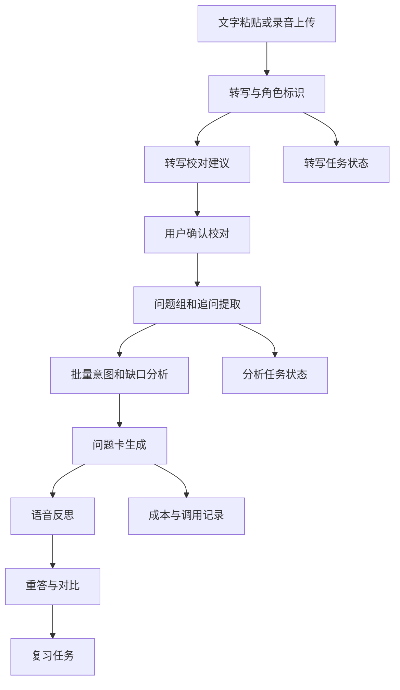

# API 与 AI 流程 v0.1

- 版本：v0.1
- 日期：2026-11-17
- 目标：定义文字导入、录音转写、问题卡生成、语音反思、重答和复习的接口与模型流程
- 首版策略：文字导入优先，录音采用事后异步转写，不做实时语音识别

## 1. 设计原则

- 原始转写不可被 AI 默默覆盖。
- 所有 AI 修正都以 diff 形式出现，用户确认后才生效。
- 问题组和追问链是主要分析对象。
- 一次复盘的主要模型调用控制在 3 到 5 次。
- 长任务异步执行，前端通过任务状态轮询或订阅。
- 任务失败可重试，重试不能重复生成问题卡。
- 成本、延迟和失败记录可观测。
- 录音默认私有，支持删除、导出和本地模式。

## 2. 总体流程



## 3. API 约定

- 基础路径：`/api/v1`
- 数据格式：JSON
- 主键：UUID
- 时间：ISO 8601
- 异步任务返回 `job_id`
- 创建型接口支持 `Idempotency-Key`
- 分页使用 `cursor` 和 `limit`
- 错误结构统一包含 `code`、`message` 和 `details`

异步任务状态：

```text
queued
→ running
→ succeeded
→ failed（可重试）
```

## 4. 核心接口

### 4.1 创建复盘场次

`POST /api/v1/sessions`

请求：

```json
{
  "title": "AI Green 项目答辩复盘",
  "session_type": "defense",
  "occurred_at": "2026-11-15T20:15:00+08:00",
  "project_profile_id": null
}
```

响应：

```json
{
  "id": "uuid",
  "status": "draft"
}
```

### 4.2 导入文字记录

`POST /api/v1/sessions/{session_id}/import-text`

请求：

```json
{
  "raw_text": "用户\\n...\\n\\nAI 评审\\n...",
  "format": "speaker_blocks",
  "language": "zh-CN"
}
```

响应：

```json
{
  "job_id": "uuid",
  "status": "queued"
}
```

处理结果：

- 生成 `transcript_turns`。
- 对明显角色标签进行规范化。
- 保留原始文本和原始顺序。

### 4.3 上传录音

`POST /api/v1/sessions/{session_id}/media`

请求类型：`multipart/form-data`

字段：

- `file`
- `media_type=audio`
- `language=zh-CN`

响应：

```json
{
  "media_id": "uuid",
  "storage_status": "uploaded"
}
```

### 4.4 发起录音转写

`POST /api/v1/media/{media_id}/transcribe`

请求：

```json
{
  "language": "zh-CN",
  "enable_diarization": true,
  "glossary_id": "uuid"
}
```

响应：

```json
{
  "job_id": "uuid",
  "status": "queued"
}
```

### 4.5 查询任务

`GET /api/v1/jobs/{job_id}`

响应：

```json
{
  "id": "uuid",
  "job_type": "transcription",
  "status": "running",
  "progress": 0.42,
  "result_available": false,
  "error": null
}
```

### 4.6 获取转写

`GET /api/v1/sessions/{session_id}/transcript`

响应包含：

- 原始发言分段。
- 开始和结束时间。
- 识别置信度，若 ASR 提供。
- 角色标签。
- 是否有待确认修正。

### 4.7 获取转写修正建议

`POST /api/v1/sessions/{session_id}/transcript/repair`

请求：

```json
{
  "scope": "low_confidence_and_glossary",
  "glossary": ["MQTT", "MyBatis-Plus", "OpenGauss", "RabbitMQ", "WebSocket"]
}
```

响应：

```json
{
  "suggestions": [
    {
      "turn_id": "uuid",
      "span_start": 12,
      "span_end": 20,
      "original": "OoCircuit",
      "suggested": "某个消息代理",
      "reason": "疑似术语识别错误",
      "confidence": 0.72
    }
  ]
}
```

约束：

- 只对低置信度、术语和明显标点问题提出建议。
- 不默认重写整段内容。
- 用户接受或拒绝后，原文和修正原因都保留。

### 4.8 用户编辑转写

`PATCH /api/v1/transcript/turns/{turn_id}`

请求：

```json
{
  "text": "修正后的文本",
  "reason": "manual",
  "expected_version": 3
}
```

约束：

- 使用版本号防止并发覆盖。
- 保留修改前后的内容。
- 用户编辑优先于 AI 建议。

### 4.9 发起问题分析

`POST /api/v1/sessions/{session_id}/analyze`

请求：

```json
{
  "mode": "questions_and_gaps",
  "include_reflection_prompts": true
}
```

响应：

```json
{
  "job_id": "uuid",
  "estimated_model_calls": 3
}
```

任务分阶段：

1. 问题组和追问链提取。
2. 批量意图和回答缺口分析。
3. 场次总结和反思提示。

### 4.10 获取问题组

`GET /api/v1/sessions/{session_id}/question-groups`

返回：

- 问题组编号。
- 主问题。
- 追问链。
- 严重度。
- 掌握状态。
- 每个问题的主要意图和缺口。

### 4.11 编辑问题卡

`PATCH /api/v1/questions/{question_id}`

允许修改：

- 问题文本。
- 问题类型。
- 意图标签。
- 缺口标签。
- 掌握状态。
- 用户备注。

### 4.12 语音反思

`POST /api/v1/questions/{question_id}/reflections`

支持：

- 上传反思录音。
- 请求转写。
- 修改反思文本。
- 删除录音。

### 4.13 重答

`POST /api/v1/questions/{question_id}/retries`

请求：

```json
{
  "audio_media_id": "uuid",
  "answer_text": null
}
```

响应：

- 保存第 N 次重答。
- 生成与上一次回答的对比。
- 返回结论、证据和边界三个维度的变化。

### 4.14 复习任务

`GET /api/v1/review-tasks`

`POST /api/v1/questions/{question_id}/review`

请求：

```json
{
  "result": "completed",
  "self_rating": 3
}
```

### 4.15 成本与调用记录

`GET /api/v1/sessions/{session_id}/usage`

返回：

- 模型调用次数。
- token 数。
- 估算费用。
- 延迟。
- 失败任务。
- 是否超过用户设置的单场预算。

### 4.16 删除和导出

`DELETE /api/v1/sessions/{session_id}`

`GET /api/v1/sessions/{session_id}/export?format=markdown`

删除时应清理：

- 原始文本。
- 录音和视频。
- 转写。
- 问题卡。
- 反思。
- 重答。
- 复习记录。
- 模型统计中的私有引用。

## 5. AI 调用流程与预算

### 5.1 文字导入版本

目标调用次数：3 次。

| 步骤 | 调用 | 输入 | 输出 |
|---|---|---|---|
| 问题提取 | 1 次 | 规范化后的转写和角色 | 问题组、追问链和问题编号 |
| 批量分析 | 1 次 | 问题卡片段、上下文摘要和分类规范 | 意图、缺口、证据和置信度 |
| 场次总结 | 1 次 | 问题摘要、缺口统计和反思提示 | 本次复盘总结和练习任务 |

### 5.2 录音版本

在文字版本基础上增加：

- 1 次 ASR 转写。
- 1 次局部转写修正建议。

注意：

- ASR 是转写任务，不应把整段音频交给大语言模型。
- 转写修正只处理低置信度、术语和数字片段。
- 分析阶段仍然只使用问题和回答片段，不重复发送全文。

### 5.3 用户后续动作

- 语音反思：每次 1 次转写，必要时 1 次整理。
- 重答对比：每次 1 次结构化对比。
- 周报：按需批量生成，不每次打开页面都调用模型。

### 5.4 输入压缩

- 向问题分析阶段发送问题组、前后两轮上下文和场次摘要。
- 不重复发送整场转写。
- 对已有问题卡使用版本号，未变化则不重新分析。
- 对同一场次缓存分类结果和向量。

## 6. ASR 与 AI 辅助识别策略

### 6.1 ASR 第一层

优先获得：

- 转写文本。
- 时间戳。
- 说话人区分。
- 词级或片段级置信度。

### 6.2 规则和术语第二层

使用项目术语表进行确定性修正：

- 技术栈名称。
- 产品名称。
- 组件名称。
- 数字和单位。
- 常见缩写。

### 6.3 AI 第三层

AI 仅处理：

- 低置信度片段。
- 不符合上下文的术语。
- 标点和断句。
- 明显的同音词错误。
- 角色标签不确定的片段。

AI 输出必须包含：

- 原文。
- 建议文本。
- 原因。
- 置信度。
- 是否改变语义的判断。

### 6.4 用户确认

- 默认不自动应用 AI 修正。
- 展示逐条 diff。
- 用户可以接受、修改或忽略。
- 用户可锁定某一段，防止重复修正。

### 6.5 不允许的行为

- 不允许 AI 根据个人猜测补出用户没有说过的事实。
- 不允许把不确定的数字“修正”为看起来合理的数据。
- 不允许重写整段回答来提升表达质量。
- 不允许把低置信度结果标成确定事实。

## 7. 任务和失败处理

### 7.1 幂等

- 创建分析任务使用 `session_id + transcript_version + analysis_version` 作为幂等键。
- 同一版本重复请求返回已有任务。
- 转写任务使用媒体文件哈希和 ASR 配置生成幂等键。

### 7.2 重试

- ASR 失败允许重新转写。
- AI 分析失败允许从失败阶段继续。
- 重试不能覆盖用户已确认的问题卡。
- 失败任务保留错误码、耗时和调用成本。

### 7.3 超时

- 短任务 60 秒。
- 长音频转写使用异步任务并显示进度。
- 前端应允许用户离开页面后回来查看状态。

## 8. 隐私和安全

- 上传使用短期签名地址。
- 音频和原始转写默认私有。
- 模型调用前移除不必要的个人身份信息。
- 日志不记录全文和密钥。
- 用户删除场次时执行级联清理。
- 可选本地 ASR 和本地模型模式。

## 9. 首轮验收

### 9.1 文字导入

- 导入种子样本。
- 识别约 20 个题组。
- 生成 22 张问题卡。
- 至少关联 10 条追问。
- 至少识别 6 类主要缺口。
- 显示每次模型调用和成本。

### 9.2 录音增强

- 上传一段测试录音。
- 完成异步转写。
- 展示至少 3 条术语或低置信度修正建议。
- 用户确认后保留修改痕迹。
- 分析阶段只使用修正后的转写。

## 10. 下一步

1. 根据本文件实现 API mock。
2. 制作导入、转写校对和问题卡三个页面的低保真原型。
3. 编写数据表迁移和种子数据脚本。
4. 先完成文字导入纵向切片，再接录音和 ASR。
